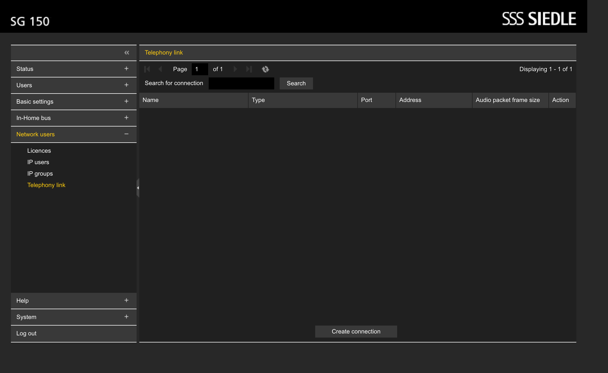
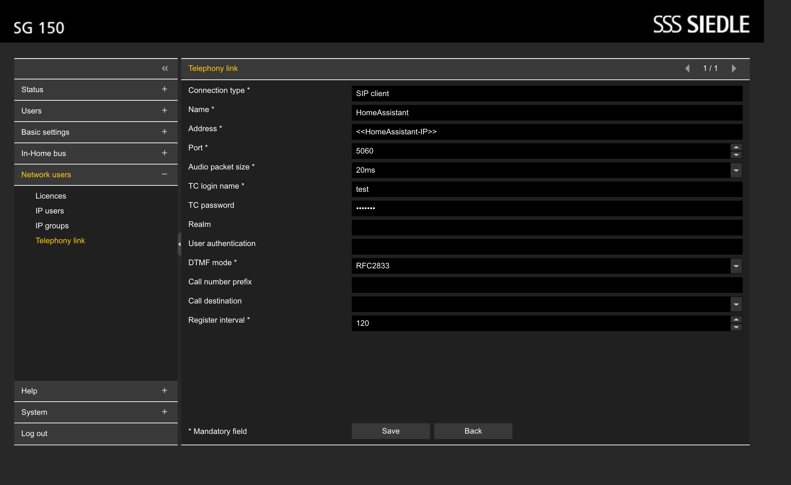
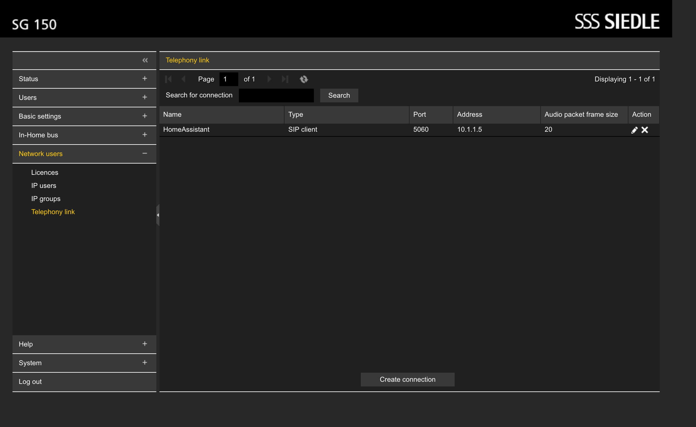
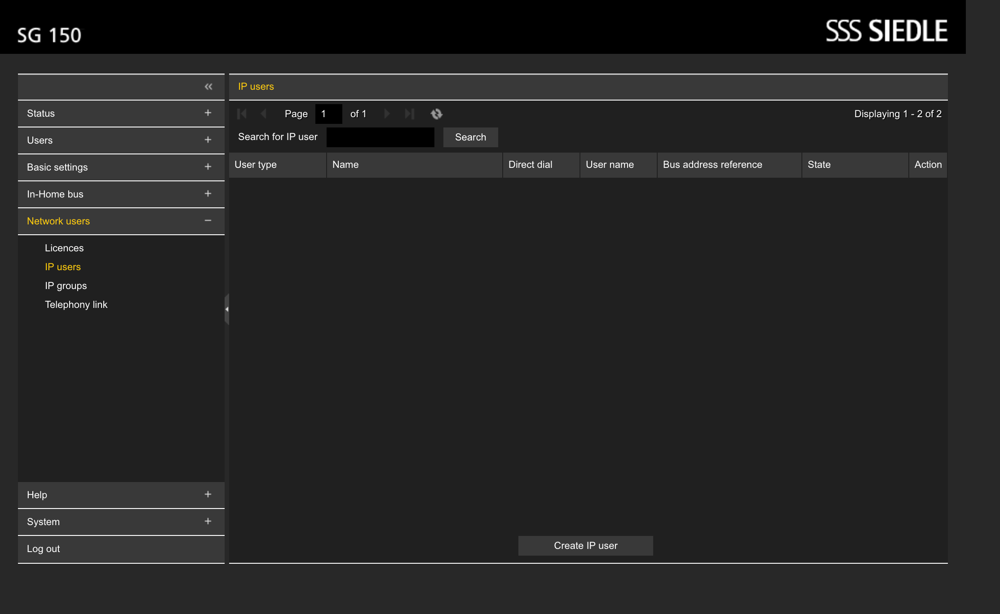
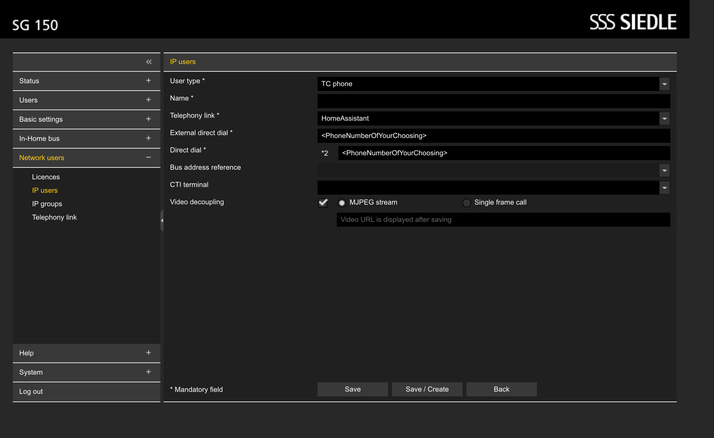

# Siedle Gateway 150 Integration

This Home Assistant custom integration allowing integration with Siedle Gateway 150 (SG-150) via a local connection. It is developed to integrate a Siedle Door Camera with Home Assistant.

This integration will run a minimal SIP Server that can be configured in the SG-150 as a telephone device.

Currently the integration exposes:

- Gateway information: MAC address, SIP connection status and a light switch button
- All phone devices known to the SG-150, with their phone number
- Door stations, with a door opener button
- A camera for each video stream, with optional two-way audio (see [Two-way audio](#two-way-audio))
- A bell that rings when the door station calls Home Assistant
- A Hang Up button next to each camera
- A media source with the pictures the gateway stored during calls, per PBX phone (Media → Siedle Gateway)
- Actions to control the SG-150:
  - start_call: Start a phone call within the In-Home system
  - stop_call: Stop a phone call within the In-Home system
  - send_sip_info_dtmf: Sends a DTMF signal to the Siedle Gateway during an In-Home phone call
  - get_active_calls: Returns a list of active call IDs (`active_calls`) and, in `calls`, each call's direction and the caller/callee device (`id`, `name`) when known.
  - play_audio: Play a media_source_id to an active call (Supporting wav/mp3, see [Tips & Tricks](#tips--tricks))
  - Every action takes an optional `config_entry_id` to pick the gateway; it can be omitted when only one gateway is set up.

# Disclaimer

⚠️ This custom component is an independent project and is not affiliated with Siedle. It has been developed for my own needs. Any trademarks or product names mentioned are the property of their respective owners. ⚠️

# Configuration

> This configuration will require a license for the SG-150 that includes the "Telephony" feature.
> You can check this by logging into your SG-150 and navigating to `Network users -> License`.  
> Check the "Telephony" row to see if you have at least one license remaining.

To get the most of this integration you need to configure the SG-150 to connect to the SIP-Server provided by this extension.

While setting up the integration within Home Assistant you will be asked to provide the following information to connect to your SG-150:

- Host Address (IP Address of the SG-150)
- Username (in most cases `admin`)
- Password (the one used for the web interface)

## Options

Home Assistant then sets up its own SIP server, which the SG-150 connects to like a telephone. You choose these options during setup, and can change them later with **Configure** on the integration:

| Option | Default | What it means |
|---|---|---|
| SIP Caller IP | | The IP address of your Home Assistant. The SG-150 uses it to reach Home Assistant. |
| SIP Username | | A name of your choosing. You enter the same name in the SG-150. |
| SIP Password | | A password of your choosing. You enter the same password in the SG-150. |
| SIP Number | | The phone number Home Assistant has in your In-Home system. |
| SIP Port | 5060 | The port the SG-150 connects to. |
| SIP Auto Answer | On | Whether Home Assistant answers when the door station calls. The camera only gets a picture during a call. While Home Assistant holds a call, your other indoor stations can't take it (see [Limitations](#limitations)). With two-way audio on, you can turn this off and answer from the camera instead. |
| Two-way audio | Off | Lets you hear and talk to the person at the door from the camera. See [Two-way audio](#two-way-audio). |
| First RTP Port / Last RTP Port | 5004 / 5013 | The ports used for the sound of calls, one per call at the same time. Only change them if they clash with something else. The SG-150 must be able to reach them, so allow them in your firewall if you have one. |

## Camera

Each video stream of the SG-150 becomes a camera in Home Assistant. In most setups it belongs to the TC phone you create for Home Assistant (see [below](#create-a-tc-phone-connected-to-the-sip-gateway)). The camera shows **Streaming** while there is a call with its device, and **Idle** otherwise.

Without two-way audio, the camera shows the picture only. With two-way audio on, its live view also plays the sound from the door station and has a talk button.

## Buttons

| Button | Where | What it does |
|---|---|---|
| Lightswitch | The gateway | Triggers the light switch of your In-Home system. |
| Door Opener | Each door station | Opens the door. |
| Hang Up | Next to each camera | Ends the call shown by that camera. If there is no call, Home Assistant shows an error. |

## Two-way audio

With **Two-way audio** turned on, you can hear the door station and talk back from the camera's live view, like on an indoor station. This, as of writing, needs Home Assistant 2026.11 or later, and the following configuration:

1. Turn on the Labs feature under **Settings → System → Labs → Two-way audio**. Two-way audio is a preview feature, and Home Assistant only shows the talk button once it is turned on there.
2. Open Home Assistant over HTTPS. Browsers only let a page use your microphone on a secure connection.
3. Turn on **Two-way audio** in this integration's options.

The camera's live view then shows a talk button.  

What happens when someone rings depends on the integration's **SIP Auto Answer** option:

- **On:** Home Assistant answers straight away, as before. You hear the door station when you open the live view, and pressing talk lets them hear you.
- **Off:** Home Assistant rings along with your indoor stations. Pressing talk answers the call. If someone answers on an indoor station first, or nobody answers within a minute, Home Assistant leaves the call to them.

The call ends when you close the live view you talked from, or when you press **Hang Up**. Just watching the live view never ends a call, except when the door station hangs up.

## Configure the SG-150 to connect to the SIP-Gateway

1. Login to your SG-150 and navigate to Network users -> Telephony link.  
   
1. Click on "Create connection"  
   
1. Fill in the following values:
   | Field | Value |
   |---------------------|----------------------|
   | Connection Type | SIP client |
   | Connection Name | HomeAssistant |
   | Address | `<HomeAssistant-IP>` |
   | Port | `<PortOfYourChoosing>` |
   | TC login name | `<NameOfYourChoosing>` |
   | TC Password | `<PasswordOfYourChoosing>` |
   > Everything else can stay default.
1. Click on "Save" -> You should now see "Changes have been implemented. Connection status: successfully registered."
1. When going back to the overview you should see the new connection listed
   

> In HomeAssistant the entity `binary_sensor.sgs_homeassistant_sip_connection` will indicate the connection status and should be "On" now.

## Create a TC phone connected to the SIP-Gateway

1. Login to your SG-150 and navigate to Network users -> IP users.  
   
1. Click on "Create IP user"  
   
1. Fill in the following values:
   | Field | Value |
   |---------------------|----------------------|
   | User Type | TC phone |
   | Name | `<SomeConnectionName>` (not important) |
   | Telephony link | HomeAssistant |
   | External Direct Call | `<PhoneNumberOfYourChoosing>` (same as integration configuration) |
   | Direct Call | `<PhoneNumberOfYourChoosing>` |
   | Video decoupling | `MJPEG stream` |
   > Everything else can stay default.
1. Click on "Save/Create"

> In HomeAssistant you should now see a new camera entity representing the video stream of this TC phone. You might need to reload the integration to see the new entity.


## Limitations

The In-Home bus has a single speech/video channel. While Home Assistant holds a call, a indoor stations get a busy tone and no image. So an automation that grabs the channel on every doorbell press will interfere with such a system.

This also applies to the fact that you won't be able to call the Door if a call is already in progress. So you can't start a direct door call while someone is ringing.

## Tips & Tricks 

### Sending DTMF signals

> Sending DTMF signals with a delay will result in the SG-150 ignoring the signal. So a script that sends multiple signals in a row should be used.
Sending DTMF signals to the first active call can be done using the following script:


```yaml
sequence:
  - action: sg_150.get_active_calls
    response_variable: calls
  - variables:
      cid: "{{ calls.active_calls[0] }}"
  - action: sg_150.send_sip_info_dtmf
    data: {call_id: "{{ cid }}", signal: "#", duration: "100"}
  - action: sg_150.send_sip_info_dtmf
    data: {call_id: "{{ cid }}", signal: "6", duration: "100"}
  - action: sg_150.send_sip_info_dtmf
    data: {call_id: "{{ cid }}", signal: "1", duration: "100"}
```

This scripts sends the DTMF signals `#61`. You can change the `signal` value to send different signals. To see what signals are supported by your SG-150 you can check **Basic Settings** -> **DTMF** in the SG-150 web interface.


### Playing TTS Audio on the Doorbell

The following action can be used play the tts audio on the doorbell.
Make sure to url encode the `<<message>>` and replace `<<call-id>>` and `<<tts-service>>` with suitable values in your HA configuration. 

```yaml
action: sg_150.play_audio
data: 
  call_id: <<call-id>>
  media_source_id: "media-source://tts/tts.<<tts-service>>?message=<<message>>&language=en"
```

# Acknowledgements

Thanks to [@DaPat78](https://github.com/DaPat78) for validating the DTMF implementation with real hardware. (See [#79](https://github.com/FWeinb/ha-sg-150/pull/79))